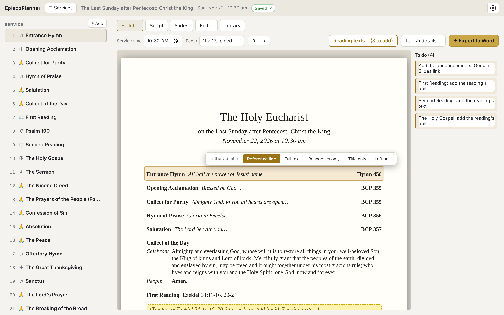
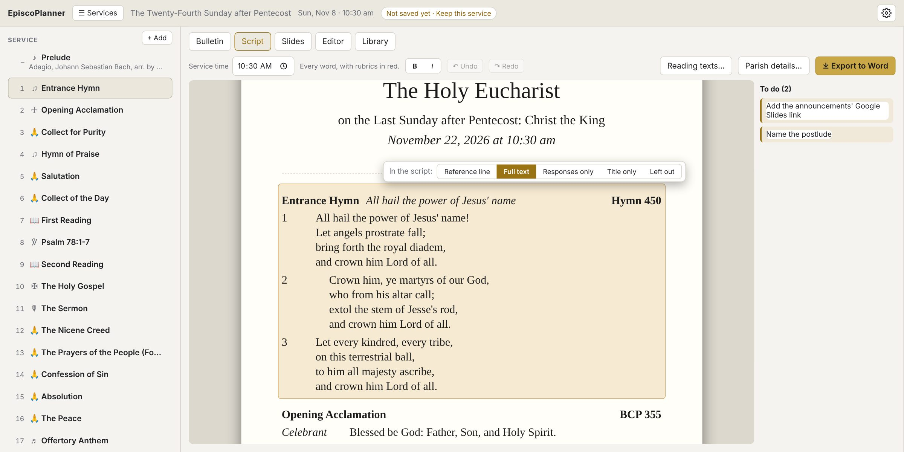

# Bulletin and script

EpiscoPlanner opens on the **Bulletin** tab: a live preview of the printed
bulletin, updated as the service changes. The **Script** tab is the
officiant's copy.

## To do

Beside the bulletin, **To do** lists what the service still needs. Click a
line and a small window opens in the middle with just what that line needs;
**Save** fills it in and closes it, and the line leaves the list. Each
window also has a link to the full screen behind it.

* **Parish details:** the name, place, logo and bulletin paper (**All parish
  details** for the rest).
* **Service time:** the time, or one of the parish's regular services.
* **Announcements' Google Slides:** just the link. It is downloaded to check
  it, showing the first slide and how many there are, or saying how to share
  the deck if Google won't send it.
* **A hymn:** the book, the **Hymn #** or words from its title or first
  line, searching the Library as you type (an exact number is picked for
  you). Tick the **verses sung**, then **Use for Entrance Hymn**. A hymn not
  in the Library yet: **Add a new hymn…** opens the Editor with its number
  and title filled in, to paste its words.
* **A reading's text:** **Open on Bible Gateway**, then paste the passage.
* **The psalm's music:** **Sung**, choosing the antiphon's music (with its
  words, for a psalm that has no antiphon yet) and the musical setting from
  the music folders; or **Said responsively, with no music**.
* **The preacher:** one of the parish's preachers, or **Someone else**.
* **An anthem, the prelude or the postlude:** title and composer. Pieces
  used in earlier services are offered as you type, and fill in the composer.

It reads **Nothing left to do ✓** when the service is ready.

## The prelude, postlude and anthems

* **The prelude** heads the bulletin: *Prelude — Adagio — Johann Sebastian
  Bach, arr. by Homer Whitfield*. Click **♪ Prelude** at the top of the
  service list, or the Prelude line at the top of the bulletin (it says *Add
  the title and composer* until you do; that isn't printed). It's also on
  the live stream's welcome before the service.
* **The postlude** closes the bulletin, set the same way: **♪ Postlude** at
  the bottom of the service list.
* Under **In the bulletin**, each can print in full, as just the word
  *Prelude* (or *Postlude*), or be left out. The script always names the
  piece.
* **A choir anthem** is an item of its own: **+ Add → Choir anthem…**, with
  its name in the service (e.g. *Offertory Anthem*), title and composer. It
  prints like a hymn: *Offertory Anthem — Ave verum corpus — W. A.
  Mozart*. To have the choir sing in a hymn's place this week, select the
  hymn and click **Make it an anthem** in the Editor: *Communion Hymn*
  becomes *Communion Anthem*, waiting for its title and composer
  (**Undo** brings the hymn back).

## How each item is printed

Click an item in the preview (or in the service list) and choose how it
appears in the bar above it:

| Choice | Prints |
| --- | --- |
| **Reference line** | The title, the opening words and the page or hymn number: *Collect for Purity — Almighty God, to you all hearts are open… BCP 355* |
| **Full text** | Every word, with speaker labels and the people's parts in bold |
| **Responses only** | The title and just what the people say, each after the line that cues it (just its end when it is long: *… Therefore we proclaim the mystery of faith:*); a litany's call and response, said after every petition, is printed once after *At the end of each petition,* |
| **Title only** | Just the title |
| **Left out** | Nothing |

The usual choice for each kind of item is underlined: Prayer Book texts as
reference lines, hymns as title and number, the sermon and announcements as
titles, and the readings, psalm, collect and prayers in full. Choosing the
usual one again clears your choice.

## Music in the bulletin

* **The psalm** prints as it's sung: how the people join in, the
  antiphon's music and the setting, the people's verses in bold, and
  **Antiphon** at the right margin where it comes back. See
  [Editing items](Editing-Items#the-psalm).
* **Music that includes its words** (a sung acclamation or Sanctus, marked
  in the Editor) prints the music without the words again. See
  [Editing items](Editing-Items#music-that-includes-its-words).
* **A hymn with a picture** prints the picture in place of its words when it
  is set to *Full text*.

## Editing in place

Click into any line of the Bulletin or Script and type, as in a word
processor:

* **Enter** starts a new line; **Backspace** at the start of a line joins
  it to the line before.
* **Ctrl/⌘ B** and **Ctrl/⌘ I** (or the **B** and **I** buttons) for bold
  and italic.
* **Esc** undoes the changes to the line you're in.
* Click an item's title to rename it.

Changes go into the item itself, so the slides change with them. Prayer
Book texts can't be typed into: make a parish version first (see
[Editing items](Editing-Items#prayer-book-texts-are-protected)).

## Reading texts

The NRSV and NRSVue are under copyright, so the apps don't include
scripture. Click **Reading texts…** and use one of two ways:

* **A Bible file.** If the parish has the translation as a JSON file, click
  **Import Bible file…** once. It's copied into the parish library folder,
  so every computer has it. From then on every reading fills itself in from
  its citation, when the propers are added and when a service is made.
  **Fill … missing readings** does it for a service that already exists, and
  **Refill** redoes one reading. Part-verses (*27a*, *9b*) are cut where the
  verse divides most naturally, so check those by eye.
* **Paste.** Click **Open ↗** to see the passage in your browser (Bible
  Gateway for the NRSVue, Oremus for the NRSV), copy it, paste it, and
  click **Use pasted**. Verse numbers, headings, footnotes and the
  copyright line are removed.

Until a reading has its text, the bulletin shows a yellow *[The text of …
goes here]*, which is also highlighted in the Word file.

Keep the Bible file in the parish library folder only, and don't share it
beyond what the parish's use of the translation allows.

## Paper and printing

* **Paper**, each sheet folded in half into a booklet: **11 × 17** into
  8½ × 11 pages (the default), **8½ × 14 (legal)** into 7 × 8½ pages, or
  **8½ × 11** into 5½ × 8½ pages. The toolbar's **Paper** is this
  service's; a regular service can have its own, and Parish details holds
  the parish's usual one.
* The service starts on the first page, under the title, in Garamond 12 pt
  with half-inch margins.
* **Service time** goes on the cover, e.g. *November 9, 2025 at 8 o'clock in
  the morning*, with the Sunday's name from the date.
* **Export to Word** saves a `.docx` (in the library's `bulletins` folder,
  named like `2025-11-09 0800 Bulletin.docx`) and opens it. It's set up for
  **book fold**: Word shows one page at a time and prints two on each side
  of the sheet, in booklet order. Print on both sides, flipping on the short
  edge, and fold the stack in half. Make last touches in Word if you like.
  (LibreOffice and Google Docs ignore book fold.)

## The script

The **Script** tab has every word of every item, the rubrics in red, in
large type on letter paper, with the Great Thanksgiving starting a new
page. **Export to Word** works the same way.

**Hymns in the script** have the bulletin's choices. Click a hymn on the
Script tab and choose in the bar above it: **Reference line**, **Full
text**, **Responses only**, **Title only** or **Left out**. The usual is
the full text (just its line while the hymn has no words or picture). A
hymn with a picture prints the picture in place of the words.

## Parish details

**⚙ Settings → Parish details…** sets what prints on the cover and back
page: the parish's name, logo, address, staff, regular services, music
licence notice and a welcome for visitors. You can also choose whether
speaker labels (*People*, *Celebrant*…) print once per block or on every
paragraph.
