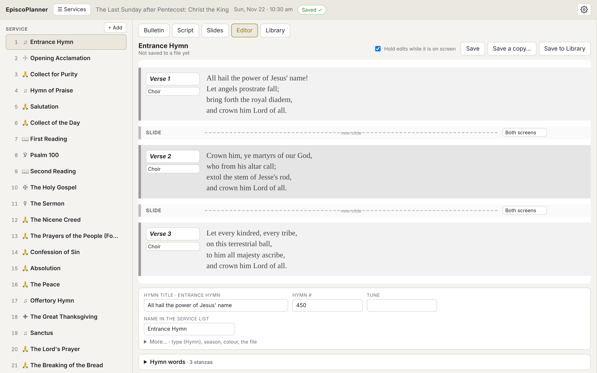
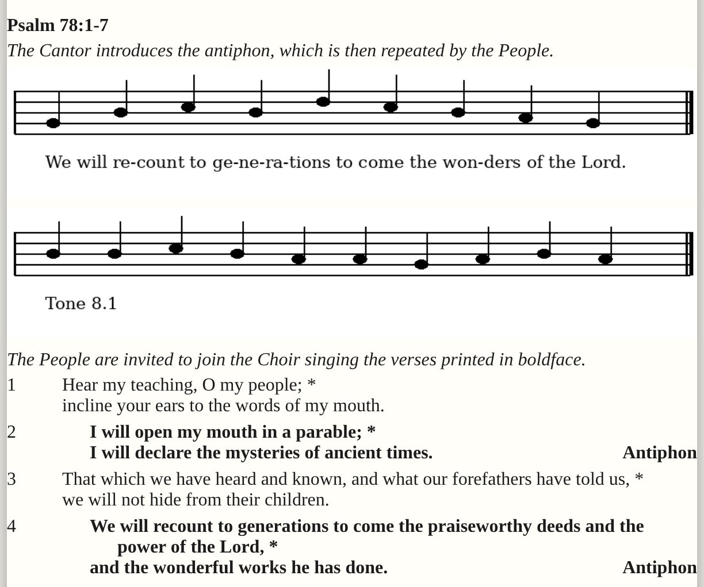
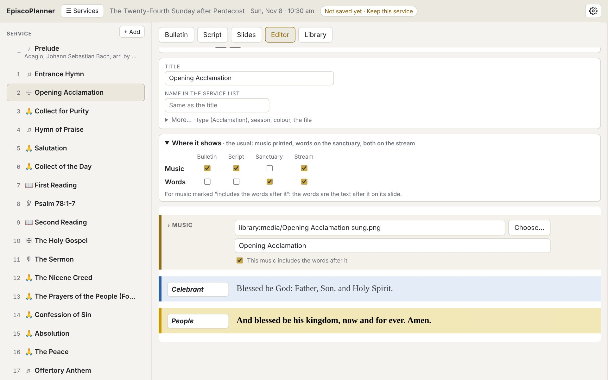

# Editing items

A service is a list of **items** (the Collect for Purity, the First
Reading, the Entrance Hymn…) down the left side. Select one and open the
**Editor** tab to change it. Changes reach the screens about a third of a
second after you stop typing, and the service saves itself.

## The service list

* **Click** an item to select it. **Drag** it up or down to move it (a gold
  line shows where it will go). Hover it for ↑ ↓ ✕.
* **+ Add** puts something new after the selected item: an item from the
  **Library**, the **Propers**, a **Blank (sanctuary only)**, made slides,
  a presentation, a web video, or a new empty item of any kind.
* **●** marks an item with changes not yet saved.

## The Editor

From top to bottom:

1. **Appearance**: the background and layout on each screen (see
   [Slide layouts and backgrounds](Slide-Layouts-and-Backgrounds)).
2. **The title**, and the citation or hymn number. **Name in the service
   list** gives the item a different name in this service only.
3. **A panel for the kind of item**: the reading's text, the psalm's
   layout, the Gospel's music, the hymn's words, the Eucharistic Prayer's
   Sanctus and Preface, or the preacher; and **Where it shows** for music
   that includes its words (below).
4. **The words.** Each row is a block of text with its speaker
   (Celebrant, People, Deacon, Reader, All, Rubric…). The speaker sets the
   colour and style: the People's parts are bold, and rubrics are red
   italics and never shown on the screens.
   In a **hymn** the rows are the song's parts instead: **Verse 1, 2 …**
   (one past the last verse is offered, and **+ ADD BLOCK** starts the next
   verse), **Refrain**, **Chorus**, **Bridge**, **Intro**, **Outro**, and for
   sung responses **Cantor**, **Call**, **All** (bold), **This Side** and
   **That Side** (a new row after Cantor or Call is All; This Side and That
   Side alternate). These are offered only in hymns.
   * Each line in a row is one line on the screen. **Enter** starts a new
     line; **Tab** and **⇧Tab** indent and outdent it.
   * Hover between rows for **+ ADD BLOCK**, **§ Heading** (starts a new
     slide with a title), **⎯ Slide break** and **♪ Music** (a picture of a
     music line).
   * A slide break can apply to **Both screens**, the **Sanctuary only** or
     the **Live stream only**.
   * **⌘B / ⌘I** (Ctrl on Windows) for bold and italic.

**Save to Library** keeps a copy of the item for later services.

### Undo

Made a mistake? **↶ Undo** at the top of the Editor (or ⌘Z, Ctrl+Z on
Windows) takes back the last change, and **↷ Redo** (⇧⌘Z) puts it back.
Typing comes back a burst at a time. It works for anything you change in
the service: words, the order, looks, settings. The bulletin's toolbar has
the same two buttons.

### Editing the item that's on the screen

While the item you're editing is on air, your edits are held back and a red
banner offers **Apply to screens** or **Discard**, so half-typed words
never appear in front of the congregation. Untick **Hold edits while it is
on screen** to apply them as you type.

## Prayer Book texts are protected

Items from the Book of Common Prayer are marked **BCP**. In a service
they're shown, not edited: the Editor shows the text read-only with a
**Make a parish version to edit** button.

Click it to save a copy dated today in the Library and switch the item to
that copy, which you can then change freely. To use your version in every
new service, select it in the Library and click **Set as default**. See
[Library and media](Library-and-Media#versions-of-prayer-book-texts).

## Hymns

The apps don't include the Hymnal 1982, which is under copyright. Hymn
words come from your parish's licensed source (the hymnal's digital
edition, a OneLicense or CCLI reprint licence…).

A hymn item in the service is named for its **place**: *Entrance Hymn*,
*Offertory Hymn*, *Communion Hymn*, *Closing Hymn*. The hymn itself is
named in the Editor's **Hymn title** and **Hymn #**. Naming the hymn never
renames its place.

**From the library** (the quickest way, once the parish's hymns are there):

1. Select the hymn slot in the service list, e.g. *Entrance Hymn*.
2. Open the **Library**, find the hymn (search "436" or its title).
3. Click **Use for Entrance Hymn**.

**Pasting the words:**

1. Select the hymn slot and open the **Editor**.
2. Paste the words into **Hymn words** and click **Apply**.
   * Numbered stanzas become one slide each.
   * A stanza marked `Refrain:` (or `Chorus:`) is the refrain. Tick
     **Repeat the refrain after every stanza** to repeat it.
   * Stanzas over eight lines are split over two slides.
   * `Words:` and `Music:` lines and copyright notices fill **Words**,
     **Music** and **Licence notice**, which the live stream shows under the
     hymn.
3. Fill in **Hymn #** and **Hymn title**, then **Save to Library** to keep
   it. The library keeps it by number and title, so it can be the entrance
   hymn this week and the closing hymn next time.

**Verses sung.** A hymn with numbered verses has **Verses sung** in the
Editor's **Hymn words**: a tick for each verse, all ticked to start. Untick
a verse that is not sung and it is left out of the slides, the bulletin
and the script, with the refrain after it; its words stay in the hymn, so
ticking it brings it back, and **All** ticks them all again. The choice is
this service's only (a hymn from the Library starts with every verse). The
bulletin's line says which verses: *Entrance Hymn — Lift Up Your Heads ·
Hymn 436, vs. 1–3 & 5* (one verse: *v. 2*). It is kept in the service plan
(`verses = [1, 2, 3, 5]`).

**A picture of the hymn.** If you have the hymn as a picture, music and
words together, choose it in **Hymn words → Picture of the hymn** (from the
`music/Hymn` folder). The bulletin (when the hymn is set to *Full text*)
and the script print the picture in place of the words; the screens still
show the words. How a hymn appears in the script is chosen on the Script
tab (see [Bulletin and script](Bulletin-and-Script#the-script)).

To bring many hymns into the library at once, see
[Library and media](Library-and-Media#hymns).

## Readings

New services have each reading's citation and responses. The text itself
comes from the parish's Bible (see
[Bulletin and script](Bulletin-and-Script#reading-texts)).

By default the slides show a reading's title and responses only (*The Word
of the Lord. / Thanks be to God.*), and the congregation follows in the
bulletin. To project the text too, tick **Show the reading on the slides**
in the reading's panel.

## The Psalm

Select the psalm and open the **Psalm layout** panel:

| Setting | Does |
| --- | --- |
| Antiphon music | A picture of the antiphon's music line, from the `music/Antiphon` folder. Printed in the bulletin and script; on both screens, the sanctuary with the words under it. |
| Musical setting | A picture of the chant or tone, from `music/Setting`. Printed in the bulletin and script under the antiphon, and shown on the live stream with every verse. |
| Antiphon words | The antiphon's text, sung by all. |
| Antiphon | Where it repeats: start and end, every 2/3/4/6 verses, or where you put it. |
| Slides | Verses per slide (1–4). |

Click **Apply** to rebuild the slides. Beside each verse, **Choir /
People** sets who sings it (the people's verses are bold). **♫ Antiphon**
between two verses puts the antiphon there.

If a psalm has no verses, paste them into **Paste verses** (each verse
starting with its number) and click **Apply**.

**In the bulletin and script** a psalm with an antiphon prints as it's
sung: *The Cantor introduces the antiphon, which is then repeated by the
People.*, the antiphon's music and the setting, *The People are invited to
join the Choir singing the verses printed in boldface.*, then the verses,
the people's in bold, with **Antiphon** at the right margin at the end of
each verse the antiphon follows.

**On the sanctuary screen** an antiphon's slide has the psalm (*Psalm
78:1-7*) at the top left and **Antiphon** at the right, then the music line
with the words under it. A psalm without an antiphon names itself at the
top of its first verses.

## The Gospel

The Gospel's slides run in the order they're used: the music line (if any),
the announcement (*The Holy Gospel…* / *Glory to you, Lord Christ*), the
title slide, the text (if shown) and *The Gospel of the Lord* / *Praise to
you, Lord Christ*.

**Music before the Gospel → Choose…** puts a picture of the Alleluia or
Gospel acclamation (from the `music/Gospel Acclamation` folder) on the
first slide. The music you choose becomes the
parish's usual one for new services. **Put the slides in order** fixes the
order after editing by hand.

## The Proper Preface

Eucharistic Prayers A and B (and Rite I's Prayers I and II) include the
Proper Preface appointed for the day, where the Prayer Book's rubric says,
on the slides and in the bulletin and script. Select the prayer in the
Editor to see which one. To use another (or none), choose it in **⚙
Settings → Service settings → Proper Preface**. Baptisms, confirmations,
ordinations and the Easter Vigil get their own automatically.

## The Sanctus

Select the **Sanctus** and choose:

* **Said**: the people's words in bold, like a prayer (new services start
  this way), or **Sung**: shown like a hymn.
* The words: **Rite II**, **Rite I**, or **A hymnal setting**. For a
  setting such as S 125, import its words like a hymn, select it in the
  Library and click **Use for Sanctus**.

In a whole **Eucharistic Prayer** (A–D, I or II), the Sanctus is inside
the prayer: select the prayer in the Editor and use its **Sanctus** row,
**Said** or **Sung**. Sung, the Sanctus gets a slide of its own shown like
a hymn; the rest of the prayer looks as before. The parish's own
Eucharistic Prayers have the row too, wherever a line begins "Holy, holy,
holy" (marked People, All, "Presider and People" …).

## Music that includes its words

Some music pictures already have the words printed under the notes: a
sung Opening Acclamation, a Sanctus, a Fraction Anthem. Put the picture
first on its slide (**♪ Music**) and the words after it as usual
(*Celebrant: Blessed be God…* / *People: And blessed be his kingdom…*).
Then tick **This music includes the words after it** under the picture.
The usual rule is then:

| | Music | Words |
| --- | --- | --- |
| Bulletin | ✓ | — |
| Script | ✓ | — |
| Sanctuary | — | ✓ |
| Live stream | ✓ | ✓ |

so the printed pages don't repeat the words, the congregation reads large
words in the church, and people at home see both. "The words" are the text
after the picture on its slide, up to the next heading, slide break or
picture; rubrics are always kept.

For an item that should be different, open **Where it shows** and tick the
places for the music and for the words; **Back to the usual** clears it.
The choice is kept with the item, so a parish version in the Library keeps
it too. (A psalm's antiphon and the music before the Gospel keep their own
layout, described above.)

## The sermon

Select **The Sermon**. **Preacher** offers the parish's preachers (those
ticked **Preaches** in Parish details → **Staff & preachers**), or someone
else, with their title (*The Rev.*, *The
Very Rev.*…) and position. The bulletin prints *The Sermon — The Very Rev.
Jane Doe, Rector* and the slide shows the same.

## Texts that aren't built in

For *Enriching Our Worship* and other supplemental texts under copyright,
use **Library → Paste a text…** with the parish's own copy. See
[Library and media](Library-and-Media#pasting-a-text).
