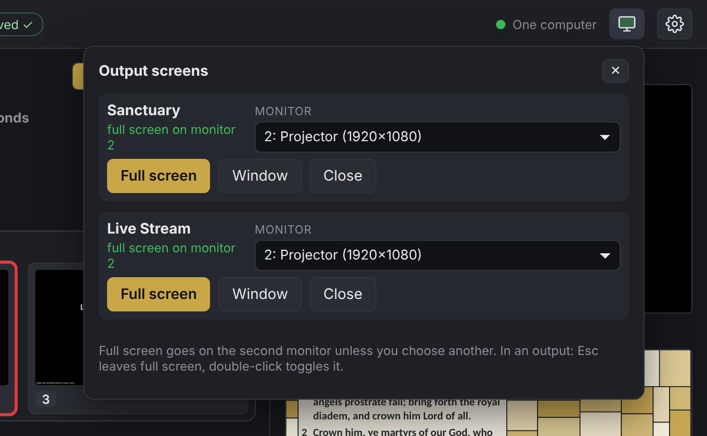

# First-time setup

When either app opens for the first time, the **Services** screen shows a
**Getting started** list. Each step has a **Do it…** button and is ticked
when it's done. You can hide the list when you're finished.

## 1. Choose the parish library folder

Everything the parish shares lives in one folder: services, saved prayers
and hymns, pictures and videos, slide layouts, parish details and exported
bulletins.

Choose it in **⚙ Settings → Parish library folder…**. The app also asks
for **your name**, which is shown to others as who changed what. There are
three ways to keep the folder:

* **Google Drive** (recommended): the app reaches the parish folder in
  Google Drive itself, without Google Drive for desktop. On the **Google
  Drive** tab:
  1. **Add the client file…**: the parish's Google client file (a `.json`
     file), from whoever set up the parish's Google project.
  2. **Sign in with Google…**: your browser opens Google's sign-in. Google
     says *"Google hasn't verified this app"*: click **Advanced**, then
     **Go to EpiscoPresenter (unsafe)**, then **Continue**. It's the
     parish's own project.
  3. **Choose the folder…**: click the parish folder. It must already be
     shared with your Google account.

  Click **Start**. The app copies the whole folder to the computer (a few
  minutes the first time) and keeps it in step with Drive every few
  seconds. The parish's Google project is set up once, in about 15
  minutes: see `docs/google-drive.md` in the project.
* **A folder on this computer**: a folder that everyone can reach some
  other way, for example one synced by *Google Drive for desktop* or
  Dropbox. On the presentation computer, mark it **Available offline** so
  services are on the computer before Sunday.
* **This computer only** keeps everything on this computer.

An empty folder is set up for you the first time. Either way each computer
works from its own copy, so a slow or missing internet connection never
holds up a service; changes go both ways as soon as they can.

Hover over **⚙ Settings → Parish library folder…** to see whether this
computer's copy is in step (*In step with Google Drive · 2 minutes ago*).
If it can't reach the folder or Google, the **⚙** gear turns gold and the
app keeps working from this computer's copy until it can.

## 2. Parish details (EpiscoPlanner)

**⚙ Settings → Parish details…** holds what goes on the bulletin:

* the parish's name, place, cover title and logo
* address, phone, website and email
* the music licence notice (for example your OneLicense number)
* the Sunday service times (for example 8:00 and 10:30)
* the clergy: Rector, Assistant and Bishop, with title, name and position
* a welcome for visitors
* the bulletin paper size

Everyone using the parish library sees the same details.

## 3. The screens (EpiscoPresenter)

Click the **monitor icon** at the right end of the top bar (beside the
**⚙** gear, which holds the settings). For the **Sanctuary** (and the
**Live Stream**, if this computer drives it) choose:

* **Full screen** on a monitor (the second monitor unless you choose
  another),
* **Window** for an ordinary window, or
* **Close**.

The screens don't open by themselves. The top bar has an icon for each
screen this computer drives: a **monitor** for the sanctuary screen and a
**broadcast** icon for the live stream (with two computers, each shows only
its own). An icon is **red** while its screen is closed and **green** once
it's open. Hover an icon to see where its screen is. In an output window, **Esc** leaves full
screen and a double-click switches it back.

On a Mac a full-screen output stays on every desktop (Space) of its
monitor, so swiping between desktops or opening Mission Control on the
control screen leaves the output showing.

## 4. One computer or two (EpiscoPresenter)

If one computer runs both the sanctuary screen and the live stream, choose
**One computer is enough**. If the live stream runs on its own computer,
see [Two computers](Two-Computers).

## 5. Plan the coming Sundays (EpiscoPlanner)

Click **Schedule services…** and choose **The coming Sundays**. See
[Planning services](Planning-Services).
