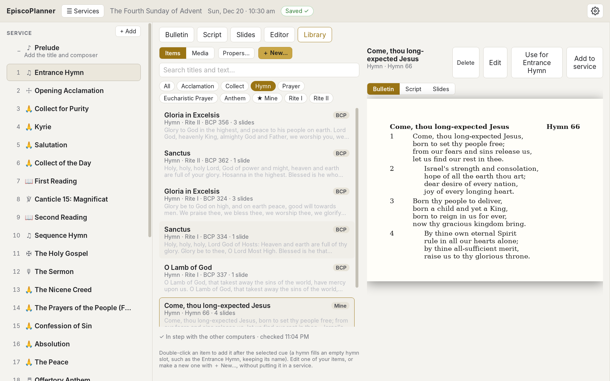

# Library and media

The **Library** tab holds everything you can reuse: Prayer Book texts,
the parish's own items and hymns, and pictures and videos.

Every computer keeps its own copy of the library and keeps it in step with
the shared parish library folder: at start-up, every 15 seconds, and a
couple of seconds after anything is saved, it fetches what the other
computers have added, changed or removed (each computer writes a change log
in the shared folder) and sends its own changes. A hymn imported on the
presentation computer reaches the planners, and the other way round, within
a minute or so.

Under the list the Library says how this computer's copy stands: **✓ In
step with the other computers** and when it last checked, **⇣ changes still
downloading**, or **⚠** and why when the shared folder can't be reached.

## Items

Filter by kind (Collect, Prayer, Hymn, Eucharistic Prayer…) and by **Rite
I** / **Rite II**, or search titles and text. Select an item to see every
slide on both screens.

In EpiscoPlanner the selected item is shown as the bulletin prints it in
full; **Script** shows it as the officiant's script prints it, and
**Slides** shows its slides on both screens (two pairs to a row). The
parish's own items can be changed right there: click a line, type, and
press Enter (Esc undoes it); the item in the Library changes, not services
already made with it. The Prayer Book's own text is shown, not edited. The
**Library** button on the Services screen opens the Library without a
service open, to add, change or tidy items. (EpiscoPresenter shows the
slides.)

**Edit and add items without a service.** **Edit** (beside one of the
parish's items) opens it in the Editor on its own: words, verses, speaker
rows, a hymn's title, number, book and tune, a picture of the hymn, a
psalm's layout. The top bar says *Library: …* with **Save to Library** and
**Done**. **Done** goes back to the Library (and to the service that was
open, if there was one). A Prayer Book item offers **Edit a parish
version**, which makes the parish's own copy and opens that. **＋ New…**
makes a new hymn (book, number, title) or a new prayer or other text (type,
rite, title) and opens it the same way; **Paste a text…** and **Import
hymns…** are there too.

Services already made keep their own copy of an item. After **Save to
Library**, the upcoming services that use it are listed (a hymn by its
number and book, anything else by its kind and title): tick the ones that
should have the new version and click **Update**. Their name for it, how
it prints and the verses sung stay as they were; a service open on someone
else's computer can't be updated until they close it.

* **BCP** items are the Prayer Book's texts, built into the app.
* **Mine** items are ones the parish saved.
* **Add to service** (or double-click) puts a copy after the selected item
  in the service. The copy belongs to that service: changing it doesn't
  change the library.
* In the Editor, **Save to Library** keeps the selected item for later
  services.

**Copies of the same item.** An item in the library more than once (the
same hymn number, or the same kind and title) is marked **×2** in the list.
Select it to see the others and click **Keep this one** to remove the rest.
Services keep their own words, so nothing else changes.

### Versions of Prayer Book texts

The Prayer Book's own text is protected. The parish can keep its own
versions of any BCP item alongside it:

1. Select the item. Under **Versions**, **BCP** is the Prayer Book's text
   and each parish copy is labelled with the day it was made.
2. **Make a copy** copies the version shown. **Add & edit** puts it in the
   open service and opens the Editor. When you've changed it, **Save to
   Library** asks whether to **update** that copy or **save a new** one.
3. **Set as default** makes the version shown the one **new services** use.
   Set **BCP** as the default to go back to the Prayer Book's text.

Services already made keep the text they were made with.

## Hymns

To bring many hymns into the library at once, save each hymn's words as a
text file named with its number and title, for example
`436 Lift Up Your Heads.txt` or `S 280 Gloria.txt`. Then click
**Library → ＋ New… → Import hymns from files…** and choose the files.

Hymns in the library are kept by **number and title**, never by their place
in a service, so the same hymn can be the entrance hymn one week and the
closing hymn the next. To use one, select the hymn slot in the service
(e.g. *Closing Hymn*), select the hymn in the Library and click **Use for
Closing Hymn**. Double-clicking the hymn does the same while the slot is
still empty; otherwise a double-click adds the hymn after it. The slot keeps
its name (*Closing Hymn*) and the hymn's own title and number go in the
bulletin.

**Hymn books.** A hymn's **Book** (in the Editor, beside **Hymn #**) says
which book its number is in: *The Hymnal 1982* (the usual), *Wonder, Love,
and Praise*, *Lift Every Voice and Sing II*, *Voices Found*, *My Heart Sings
Out*, *El Himnario*, **Another book…** (type its name) or **Not from a
book**. The bulletin and slides print the number with its book: *Hymn 436*,
*WLP 787*, *LEVAS 151*; a song from no book has no number. Two hymns with
the same number in different books are different hymns in the Library.
**Import hymns…** reads the book from the start of a file name:
`WLP 787 You Are the Light.txt`, `LEVAS 151 Lift Every Voice.txt`.

**Hymns only, for a hymn's place.** While a hymn's place (*Entrance Hymn*,
*Closing Hymn* …) is selected in the service, the Library shows hymns
only. Click **All** (or another kind) to see everything; selecting
another item puts the list back.

**A picture of the hymn.** In the Editor's **Hymn words**, **Picture of the
hymn** takes a picture of the hymn's music and words (from the `music/Hymn`
folder). The bulletin (in Full text) and the script print the picture in
place of the words; the screens show the words.



Only use hymn words the parish is licensed to project.

## Pasting a text

For texts under copyright that the parish uses from its own copy (the
Eucharistic Prayers of *Enriching Our Worship*, for example):

1. **Library → ＋ New… → Paste a text…**
2. Give it a title, a type and where it comes from ("EOW 1, p. 57"; this is
   printed in the bulletin).
3. Paste the text, starting each speaker's part with the speaker's name as
   the book prints it:

   ```text
   Presider    The Lord be with you.
   People      And also with you.
   ```

   *Presider and People* or *All* is said together (bold). Lines in
   [brackets] become rubrics.
4. Choose its **type** (a prayer, *Prayers of the People*, a *Eucharistic
   Prayer*, …) and **rite** (Rite I, Rite II or Either).
5. **Add to library**, then look it over in the Editor.

### The parish's own Prayers of the People and Eucharistic Prayers

A Eucharistic Prayer in the library, and a prayer marked as **Prayers of
the People**, are offered beside the Prayer Book's when services are made
(**Schedule services**, under *The parish's own*) and in **⚙ Settings →
Service settings** for the open service, for services in its rite.

* To mark a prayer already in the library, select it and tick **Prayers of
  the People** under its name.
* A parish Eucharistic Prayer takes the place of the dialogue and the
  separate Sanctus (it has both). *Dialogue and Sanctus only* in Service
  settings puts them back.
* The day's Proper Preface goes in where the prayer says "Here a Proper
  Preface is sung or said…", or after the presider's first words following
  "It is right to give … thanks and praise".

## Propers

**Library → Propers…** gives the Collect of the Day, readings and psalm for
any date: Sundays (Years A, B and C, Track 1 or 2), holy days, and the
Lesser Feasts. The Prayer Book's rules decide which observance takes
precedence. Tick what you want and click **Add to service**.

## Media

**Library → Media** holds pictures (`png`, `jpg`, `gif`, `svg`, `webp`) and
videos (`mp4`, `mov`, `m4v`, `webm`). **Import…** copies files in. Select
one to:

* **Add to service**, to show it full screen on both screens (videos play
  while the item is on, with sound from the sanctuary computer),
* **Add (sanctuary only)**, to show it on the sanctuary screen while the
  stream shows the camera,
* use it as the **background** of the selected item,
* rename or delete it.

### Tags

Type tags under a picture's name (for example *Advent*, *music*,
*Christmas pageant*). Separate several with commas and press Enter; ✕
removes one. The **Tags** chips above the pictures show only those with a
tag, and the search finds names and tags. The picture chooser used for
music lines and slide pictures has the same search and tags.

## Music folders

Pictures of music are kept apart from the media, in the parish library's
`music` folder, one folder for each use:

* `music/Antiphon`: psalm antiphons;
* `music/Setting`: the chants and tones psalm verses are sung to;
* `music/Gospel Acclamation`: the Alleluia or acclamation before the Gospel;
* `music/Hymn`: pictures of hymns, music and words.

The Editor's **Choose…** for each of these opens its folder: pick a
picture, or **Import…** to add new ones. **From the media library…** takes
one added there earlier. See [Editing items](Editing-Items) for the psalm
and for music that includes its words.
