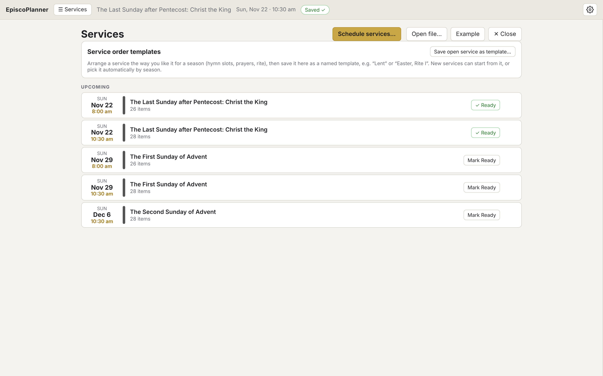

# Planning services

## The Services screen

Both apps open on **Services**. Open it again any time with **☰ Services**
in the top bar.

* **Upcoming** lists the scheduled services by date, with each day's name
  in the church year, its lectionary year and Proper, and its colour.
  Click one to open it. Hover it and click ✕ to delete it.
* **Past services** are folded away below.
* **From the planner** (EpiscoPresenter) lists the services marked ready in
  the planner.
* **Open file…** opens a service from anywhere; **Example** opens a sample
  service to try things out.

## Schedule services

**Schedule services…** opens one window with two choices:

* **One service:** a service on a date and time, of any kind. The title
  fills itself in from the church year (*The Twenty-Fifth Sunday after
  Pentecost*); you can change it. Click **Create & open**.
* **The coming Sundays:** a service for each of the next 1–8 Sundays (4 by
  default) that doesn't have one yet, at each of the parish's service times
  that's ticked. Click **Schedule**.

Both share these settings, which are remembered for next time:

| Setting | Choices |
| --- | --- |
| **A deacon is serving** | On by default. Without a deacon the Deacon's parts are labelled *Priest*. |
| **Starting from** | The standard order, a saved template, *By season*, or a copy of an existing service (below). |
| **Rite** | Rite II (the default) or Rite I. |
| **Readings** | Track 1 or Track 2, for the Season after Pentecost. |
| **Bible** | NRSVue or NRSV, for the reading texts. |
| **Prayers of the People** | Forms I–VI, the Rite I prayer, *usual for the rite*, or the parish's own (see [Library and media](Library-and-Media#the-parishs-own-prayers-of-the-people-and-eucharistic-prayers)). |
| **Eucharistic Prayer** | *Dialogue and Sanctus only*, or a whole prayer: A–D (Rite II), I or II (Rite I), or the parish's own. A whole prayer includes the Sanctus and the Proper Preface. |

All of these can be changed later for one service in **⚙ Settings →
Service settings**.

### What a new service contains

The **standard order** is built in the chosen rite and adjusted for the
season: Welcome & Announcements, Entrance Hymn, the Opening Acclamation
(the Easter or Lent form in those seasons), Collect for Purity, Gloria (the
Kyrie in Advent and Lent), Salutation, **the propers**, Sermon, Nicene Creed,
Prayers of the People, Confession, Absolution, Peace, Offertory Hymn, the
Great Thanksgiving, Sanctus, Lord's Prayer, Breaking of the Bread,
Invitation, Communion Hymn, Postcommunion Prayer, announcements, Closing
Hymn and Dismissal. The **Prelude** and **Postlude** have their places at
the top and bottom of the service list, waiting for the music's title and
composer.

**The propers are added for you** from the lectionary: the Collect of the
Day, the readings and psalm (of the chosen track) and the Gospel, with the
psalm's verses from the Prayer Book. The hymn slots hold a note until you
choose the hymns.

### Kinds of service

**Service** chooses the order:

* **Holy Eucharist** for Sundays and holy days.
* **Ash Wednesday, Palm Sunday, Maundy Thursday, Good Friday, Holy
  Saturday** and **the Great Vigil of Easter**, suggested from the date,
  each in the Prayer Book's own order.
* **Ordination** of a deacon, priest or bishop.
* **The Celebration and Blessing of a Marriage** and **the Burial of the
  Dead** (in Rite I or Rite II), each with or without Holy Communion (tick
  **With Holy Communion**).
* **Event (not a service)** for a meeting, concert or dinner: it starts
  with one blank item of slides. See
  [Slides, events and video](Slides-Events-and-Video).

And for any Eucharist:

* **A bishop presides:** the Celebrant's parts are labelled *Bishop*, and
  the Bishop's blessing is added.
* **Baptism:** Holy Baptism, or the Renewal of Baptismal Vows, in place of
  the Creed.
* **Confirmation, Reception, Reaffirmation**, with the bishop.

## Templates

A template is your own order of service, for example *Lent, Rite I* or
*Easter*. Arrange a service the way you want it for the season (items, hymn
slots, backgrounds, rite), then:

1. **☰ Services → Save open service as template…**
2. Name it and tick the seasons to **use it automatically for** (or none, to
   choose it by name).

When **Starting from** is **By season**, each new service uses the template
for its season, and the standard order where there is none. The **Service
order templates** card on the Services screen lets you edit, rename or
delete templates. Services already made from a template don't change.

## Propers for another day

To use a holy day's readings, a Lesser Feast or different readings:
**Library → Propers…** (or **+ Add → Propers (Collect, readings, psalm)…**). Pick the date and
**Observance**, tick what you want (Collect in Rite I or II, readings, psalm,
alternatives) and click **Add to service**. The items go after the selected
item in the service list.

## When someone else has a service open

Each planner marks the service it has open in the shared folder. On the
**Services** screen a service someone else has open says **Open on
Rector's computer** (the name set with the parish library folder). If you
open it, it's **view only** and the top bar says **Open on Rector's
computer · Take over**:

* To look, or to print the bulletin, just carry on.
* To change it, click **Take over**. It reloads as last saved and is yours;
  on the Rector's computer it turns view only within about half a minute,
  with a note saying who took it over. What they changed before that is
  saved.

A computer that crashes or goes to sleep stops counting after about 3
minutes.

## Saving

Services save themselves about a second and a half after each change. The
top bar shows **Saved ✓** or **Saving…**. The example (or a copy) shows
**Not saved yet · Keep this service**: click it to keep it with your
services.

## Sending a service to the presentation computer

On the planner's Services screen, click **Mark Ready** when a service is
ready to go to the presentation computer (it turns green: **✓ Ready**).
Within a minute EpiscoPresenter has its own copy, with the pictures and
videos it uses. EpiscoPresenter never runs a service from the shared folder,
so a Google Drive outage or a late edit can't change what's on the screens
during a service.

Later changes in the planner are copied over too, unless the service is
open on the presentation computer or was changed there. Then the service
shows **Updated in the planner** (or **Changed in both**), and
**⟳ Updated in the planner** appears in the top bar: click it when it's safe
to take the planner's version. Click **✓ Ready** again to stop sending
updates.
