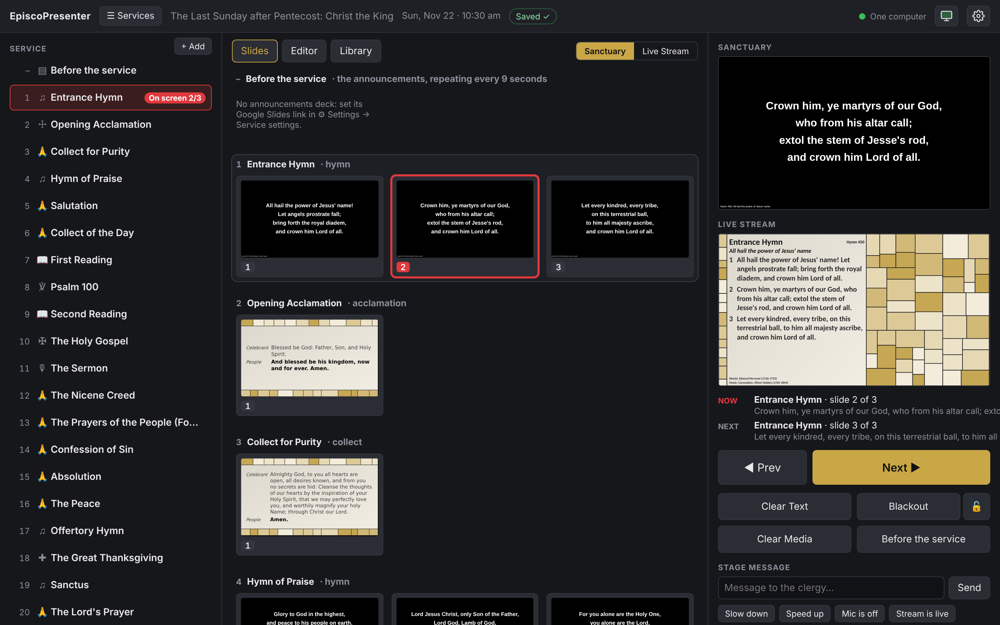
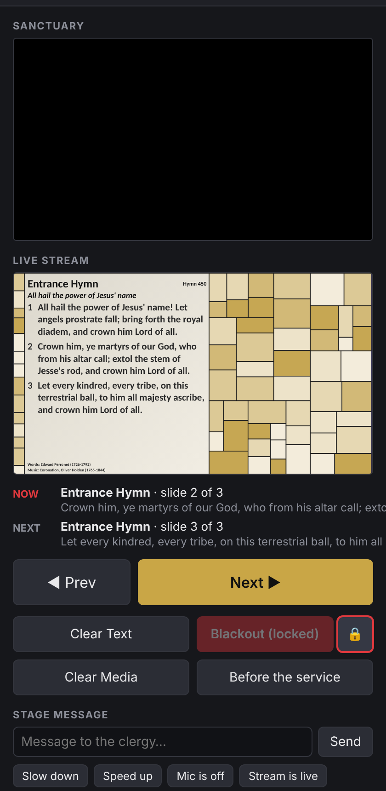

# Running a service

EpiscoPresenter's window has three parts:

* **Left:** the service list.
* **Middle:** the **Slides** tab (every slide of the service), the
  **Editor** and the **Library**.
* **Right:** what's on each screen now, and the controls.

## Before you start

1. Open the service from **☰ Services** (services sent from the planner are
   under **From the planner**).
2. Open the screens with the **monitor icon** at the right end of the top
   bar, beside the **⚙** gear.
3. Check the two previews on the right: **Sanctuary** and **Live Stream**.

Until the first item is shown, **Before the service** runs: the
announcements slides loop on the sanctuary screen, and the live stream
shows its welcome: the service, date and time, "Welcome to" the parish (its
name from **Parish details**), and the prelude (set with **♪ Prelude** at
the top of the service list, or **⚙ Settings → Service settings**).

## The choir anthem

**+ Add → Choir anthem…** adds the anthem where the choir sings it (it is
named *Offertory Anthem* to start with; change the name for another place).
Give it its title and composer. When you reach it, the live stream shows a
lower third: the name above, and the title and composer in the bar.

## Moving through the service

| To | Do |
| --- | --- |
| Go to the next slide | **→**, **↓**, **Space**, **Page Down** or **Next ▶** |
| Go back | **←**, **↑**, **Page Up** or **◀ Prev** |
| Jump to an item | Double-click it in the service list |
| Jump to a slide | Click it in the **Slides** tab |

A presentation clicker that sends Page Up / Page Down works too.

**NOW / NEXT** under the previews name the slide on screen and the one
coming. In the **Slides** tab the slide on screen has a red frame and moves
to the second row whenever it changes, so the slide before is just above it
and the slides coming up are in view below.

### The end of a reading

A reading shown by its title (the reader reads from the book) has a step of
its own between the title and *The Word of the Lord*, for the operator
only. The screens keep the title; the step's card (dashed, *End of the
reading · only here*) and **NOW** show the last words of the passage under
**Listen for**. Press **Next** when the reader gets to those words, and the
response comes up on time. The step is there once the reading's text is in
the service; without the text the title goes straight to the response.

**Next** moves both screens together. The live stream sometimes fits two
of the sanctuary's slides on one (or splits a long one), so at some steps
one screen holds its slide while the other moves on. That's expected; the
Slides tab marks those steps *holds*.

## The buttons

| Button | Key | Does |
| --- | --- | --- |
| **Clear Text** | Esc | Hides the words and leaves the background. Undone when you move to another slide. |
| **Blackout** | B | Blacks out the **sanctuary screen only**. The live stream carries on. Stays on until pressed again. |
| **🔓 / 🔒** | | Locks Blackout as it is, on or off, so it can't be changed by accident (below). |
| **Clear Media** | M | Stops a picture or video. |
| **Before the service** | | Goes back to the announcements loop. |

A button stays red while its effect is on.

### Locking Blackout

Click **🔓** beside Blackout to lock it (**🔒**). While it's locked, the
Blackout button is greyed out and **B** can't change
it, on every computer. Use it, for example, to keep the sanctuary screen
dark through the sermon and the Peace. Click **🔒** to unlock.

## Stage messages

Type a message under **Stage message** and press **Enter**, or click a
preset (*Slow down*, *Speed up*, *Mic is off*, *Stream is live*). It appears
on the control screens of every computer, never on the sanctuary screen or
the stream. **Clear** removes it.

## Announcements

Put the parish's Google Slides link in **⚙ Settings → Service settings →
Announcements deck**. Share the deck as **Anyone with the link can view**.

* The slides loop **Before the service**, a slide every 9 seconds.
* An **Announcements** item set to **One time through** has a card for each
  slide. Next and Prev step through them, or click any slide to show it.
* After changing the deck in Google Slides, click **↻ Refresh slides**.
* Animations and videos inside the deck don't play: the slides are shown as
  pictures.

## Planned blanks

* **+ Add → Blank (sanctuary only)** adds a point where the sanctuary
  screen goes black and the stream shows the camera.
* Any item can be blank on one screen: in the Editor's **Appearance**, set
  the Sanctuary's look to **Blank** or the stream's to **Camera only**.

## Last-minute changes

You can edit during the service. While the item on screen is being edited,
changes are held until you click **Apply to screens** (see
[Editing items](Editing-Items#editing-the-item-thats-on-the-screen)).
